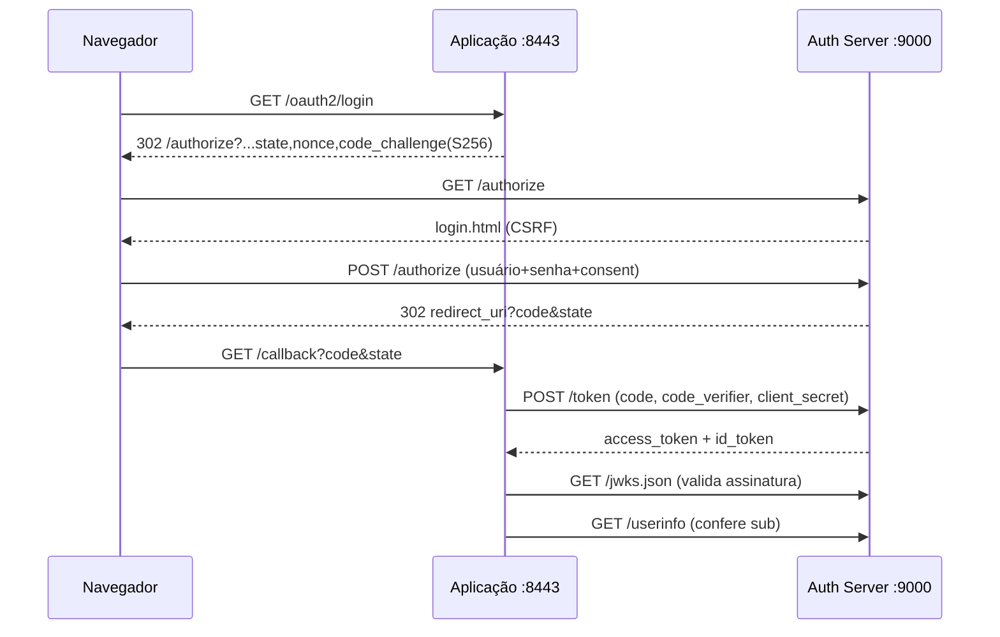

# Auth Server — Servidor de Autorização OpenID Connect (Opção 1)

Trabalho **A1/3 — 33506 Cyber Security (UNOESC)**: *Autenticação e Autorização — OAuth 2.0 + OpenID Connect (Authorization Code com PKCE)*.

Este projeto é o **Servidor de Autorização / OpenID Provider (OP)** escrito do zero. Ele autentica usuários, guarda as senhas (bcrypt), emite o **authorization code**, troca o code por **tokens** e assina o **ID Token (JWT RS256)**. A aplicação cliente (`ongApplication-`) nunca vê a senha do usuário.

| Papel (enunciado 1.1) | Quem é neste trabalho |
|---|---|
| Dono do recurso | Usuário final |
| Cliente (Relying Party) | `ongApplication-` (https://localhost:8443) |
| **Servidor de Autorização (OP)** | **este projeto (https://localhost:9000)** |
| Servidor de recursos | endpoint `/userinfo` deste projeto |

---

## 1. Tecnologias
Java **21** · Spring Boot **3.5.3** (Web, Security, Thymeleaf, JDBC) · H2 (arquivo) · Nimbus JOSE+JWT **9.47** · Lombok · Maven.

## 2. Estrutura do projeto

```
auth-server/
├── pom.xml
├── .env.example                      modelo de variáveis (SEM segredos reais)
├── scripts/gen-certs.sh | .cmd       gera o certificado TLS autoassinado
├── docs/ONG-OIDC.postman_collection.json | ...environment.json
└── src/main
    ├── java/authserver
    │   ├── AuthServerApplication.java        main + @EnableScheduling
    │   ├── config/
    │   │   ├── AuthSecurityConfig.java       Spring Security (CSRF, permissões)
    │   │   └── RsaKeyManager.java            chave RSA de assinatura, JWKS e rotação
    │   ├── controller/
    │   │   ├── OidcController.java           discovery, jwks, authorize, token, userinfo, logout
    │   │   └── RegistrationController.java   cadastro de usuários (/register)
    │   └── service/
    │       ├── OidcStoreService.java         codes, access tokens, rate limiting, PKCE
    │       ├── UserService.java              cadastro, verificação de senha, seed
    │       ├── UserRepository.java           acesso ao banco (JdbcTemplate)
    │       ├── UserRecord.java               record do usuário
    │       └── UserSeeder.java               cria usuários de teste e promove admins
    └── resources
        ├── application.yaml                  configuração (lê variáveis de ambiente)
        ├── schema.sql                        tabela users
        └── templates/ login.html · register.html · logout.html · erro.html
```

## 3. Como subir

### 3.1 Pré-requisitos
JDK 21 (com `keytool`), Maven (ou o `mvnw` do projeto) e, para gerar segredos, `openssl` **ou** PowerShell.

### 3.2 Passo a passo
1. **Variáveis de ambiente** — copie o modelo e preencha:
   ```bash
   cp .env.example .env          # Windows: copy .env.example .env
   ```
   O `.env` está no `.gitignore` e é lido automaticamente (`spring.config.import: optional:file:.env[.properties]`).

   | Variável | Obrigatória | Descrição |
   |---|---|---|
   | `AUTH_KEYSTORE_PASSWORD` | sim | senha do keystore TLS (`certs/auth-server.p12`) |
   | `AUTH_DB_PASSWORD` | sim | senha do banco H2 de arquivo (definida na 1ª execução) |
   | `OIDC_CLIENT_ID` | sim | `client_id` do cliente registrado (ex.: `ong-adocao-client`) |
   | `OIDC_CLIENT_SECRET` | sim | segredo do cliente — **o mesmo** do `.env` da aplicação |
   | `OIDC_REDIRECT_URI` | não | padrão `https://localhost:8443/callback` (comparação **exata**) |
   | `SEED_ADMIN_PASSWORD` | sim | senha do usuário de teste `admin` |
   | `SEED_USER_PASSWORD` | sim | senha do usuário de teste `operador` |
   | `OIDC_BOOTSTRAP_ADMINS` | não | usernames separados por vírgula que viram `admin` no startup |
   | `OIDC_ISSUER` | não | padrão `https://localhost:9000` |
   | `OIDC_POST_LOGOUT_REDIRECT_URI` | não | padrão `https://localhost:8443/login?logout=true` |
   | `OIDC_APP_LOGIN_URL` | não | padrão `https://localhost:8443/login` (link "ir para a aplicação" após cadastro) |
   | `OIDC_KEY_ROTATION_MINUTES` | não | padrão `1440` (24 h) |
   | `OIDC_DB_PATH` / `OIDC_SIGNING_KEY_FILE` | não | padrão `./data/authdb` e `./data/signing-key.json` |

   Gerar um segredo forte: `openssl rand -hex 32` — ou PowerShell 7: `[Convert]::ToHexString([Security.Cryptography.RandomNumberGenerator]::GetBytes(32))`.

2. **Certificado TLS** (o enunciado exige HTTPS; `localhost` é o único caso sem TLS permitido, mas o issuer deve ser HTTPS):
   ```bash
   AUTH_KEYSTORE_PASSWORD=<mesma do .env> ./scripts/gen-certs.sh
   # Windows: set AUTH_KEYSTORE_PASSWORD=<mesma do .env> && scripts\gen-certs.cmd
   ```
   Gera `certs/auth-server.p12` (keystore) e `certs/auth-server.crt` (certificado público — **a aplicação cliente importa este arquivo no truststore**).

3. **Executar**
   ```bash
   ./mvnw spring-boot:run          # ou: mvn spring-boot:run
   ```
   Log esperado: `Nova chave de assinatura gerada: kid=key-...` (ou `Chave de assinatura carregada`) e `Tomcat started on port 9000 (https)`.

4. **Verificar**
   ```bash
   curl -k https://localhost:9000/.well-known/openid-configuration
   curl -k https://localhost:9000/jwks.json
   ```
   (`-k` porque o certificado é autoassinado; no navegador, aceite o aviso uma vez.)

5. **Subir a aplicação** (`ongApplication-`) depois deste servidor — ela lê a descoberta e o JWKS daqui.

### 3.3 Usuários
- **Cadastro self-service:** `https://localhost:9000/register`. Todo cadastro nasce com role `adotante` e `email_verified=false`.
- **Usuários de teste** criados no startup (se não existirem), pelo `UserSeeder`: `admin` (role `admin`, sub `sub-admin-001`) e `operador` (role `user`, sub `sub-user-002`), com as senhas do `.env`.
- **Promover alguém a admin:** coloque o username em `OIDC_BOOTSTRAP_ADMINS` e reinicie.
- **Zerar tudo:** pare o servidor e apague a pasta `data/` (usuários **e** chave de assinatura).

---

## 4. Endpoints

| Endpoint | Método | Método Java (classe) | Função |
|---|---|---|---|
| `/.well-known/openid-configuration` | GET | `OidcController.discovery()` | metadados de descoberta |
| `/jwks.json` | GET | `OidcController.jwks()` | chaves **públicas** (JWK) |
| `/authorize` | GET | `OidcController.authorizeGet(...)` | valida a requisição e mostra o login |
| `/authorize` | POST | `OidcController.authorizePost(...)` | autentica, registra consentimento, emite o code e redireciona (302) |
| `/token` | POST | `OidcController.token(...)` | autentica o cliente, valida code + PKCE, emite tokens |
| `/userinfo` | GET/POST | `OidcController.userinfo(...)` | claims do usuário (Bearer) |
| `/logout` | GET | `OidcController.logoutPage(...)` | página que submete o POST com CSRF |
| `/logout` | POST | `OidcController.logout(...)` | encerra a sessão no provedor |
| `/register` | GET/POST | `RegistrationController.form()` / `submit(...)` | cadastro de usuário |

### 4.1 `GET /authorize`
Parâmetros (todos obrigatórios): `response_type=code`, `client_id`, `redirect_uri`, `scope` (contém `openid`; aceita `profile`, `email`), `state`, `nonce`, `code_challenge` (43 chars base64url), `code_challenge_method=S256`.

Ordem de validação em `authorizeGet`:
1. `clientAndRedirectValid(client_id, redirect_uri)` — comparação **exata** de string. Se falhar: **HTTP 400 na própria página** (`erro.html`), **sem redirecionar** (RFC 6749 §4.1.2.1 — evita open redirect).
2. `validateAuthParams(...)` — `response_type`, `state`, `nonce`, `code_challenge_method`, formato do `code_challenge`, `scope`. Se falhar: `redirectError(...)` → 302 para a `redirect_uri` cadastrada com `error`, `error_description` e `state`.
3. Sucesso: `populateFormModel(...)` + renderiza `login.html`.

### 4.2 `POST /authorize` (login)
`authorizePost` repete as validações (os campos ocultos do formulário também são entrada do usuário) e então:
1. `store.isBlocked(ip, username)` → **HTTP 429** se excedeu o limite;
2. `store.authenticate(username, password, ip)` → **HTTP 401** com mensagem genérica *"Credenciais inválidas."*;
3. sem consentimento → redirect `error=access_denied`;
4. sucesso: sessão do provedor com **id rotacionado** (`request.changeSessionId()`), `store.createAuthorizationCode(...)` e **302** para `redirect_uri?code=...&state=...` (state devolvido byte a byte igual).

O authorization code: 256 bits aleatórios, uso único, **60 s**, vinculado a `client_id`, `redirect_uri`, `code_challenge`, `sub`, `nonce`, `scope`.

### 4.3 `POST /token` (`application/x-www-form-urlencoded`)
Parâmetros: `grant_type=authorization_code`, `code`, `redirect_uri`, `code_verifier`, `client_id`, `client_secret` (**client_secret_post**) — ou `Authorization: Basic` (**client_secret_basic**).

Sequência em `token(...)`:
1. autentica o cliente (comparação em tempo constante `OidcStoreService.constantTimeEquals`) → senão `invalid_client` (401 + `WWW-Authenticate`);
2. `grant_type` ausente → `invalid_request`; ≠ `authorization_code` → `unsupported_grant_type`; cliente sem permissão → `unauthorized_client`;
3. `code`/`redirect_uri`/`code_verifier` ausentes → `invalid_request`;
4. code inexistente ou de outro cliente → `invalid_grant`;
5. **uso único atômico**: `codeRec.used.compareAndSet(false, true)`; se já usado → **revoga os tokens emitidos** (`store.revokeTokensForCode`) e `invalid_grant`;
6. expirado, `redirect_uri` diferente, `code_verifier` fora do padrão RFC 7636 ou `SHA256(verifier)` ≠ `code_challenge` (`store.verifyPkceS256`) → `invalid_grant` (o code fica "queimado" mesmo assim);
7. monta e assina o ID Token (RS256) e emite um access token **opaco**.

Resposta 200 (`Cache-Control: no-store`, `Pragma: no-cache`):
```json
{ "access_token": "…opaco…", "token_type": "Bearer", "expires_in": 900,
  "scope": "openid profile email", "id_token": "eyJhbGciOiJSUzI1NiIs…" }
```
Não há `refresh_token`: o único grant suportado é `authorization_code` (enunciado 2.8).

Erros (JSON `{"error": "...", "error_description": "..."}`): `invalid_request` 400 · `invalid_client` 401 · `invalid_grant` 400 · `unauthorized_client` 400 · `unsupported_grant_type` 400 · `invalid_scope` (em `/authorize`).

### 4.4 ID Token (JWS RS256)
Header: `{"alg":"RS256","typ":"JWT","kid":"key-20261122-101500"}`
Payload (ilustrativo):
```json
{ "iss": "https://localhost:9000", "sub": "9f6c0b9e-…-uuid", "aud": "ong-adocao-client",
  "exp": 1763820900, "iat": 1763820000, "nonce": "<o enviado em /authorize>",
  "azp": "ong-adocao-client", "name": "Maria Silva", "email": "maria@exemplo.com",
  "email_verified": false, "role": "adotante", "preferred_username": "maria" }
```
TTL = **900 s** (`TOKEN_TTL_SECONDS`). `preferred_username` é só para exibição; o vínculo na aplicação é `iss`+`sub`.

### 4.5 `GET/POST /userinfo`
Exige `Authorization: Bearer <access_token>`. Sem token, expirado, revogado ou inválido → **401** com `WWW-Authenticate: Bearer`. Devolve `sub` sempre; `name`, `role`, `preferred_username` com escopo `profile`; `email`, `email_verified` com escopo `email`.

### 4.6 `/register`, `/logout`
- **Cadastro** (`UserService.register`): usuário `[a-z0-9._-]{3,32}`, nome 2–120, e-mail válido, senha 10–72 bytes sem conter o usuário, confirmação igual; duplicidade → "Usuário ou e-mail já cadastrado."; limite **5 cadastros/hora por IP** (`OidcStoreService.allowRegistration`); CSRF obrigatório.
- **Logout:** a aplicação redireciona o navegador para `GET /logout?post_logout_redirect_uri=…`; a página submete `POST /logout` (CSRF) que invalida a sessão e faz 302 para a URI **somente se for idêntica** à cadastrada (`oidc.post-logout-redirect-uri`).

---

## 5. Fluxo completo



---

## 6. Referência de classes e métodos

### `config/AuthSecurityConfig`
| Método | O que faz |
|---|---|
| `securityFilterChain(HttpSecurity)` | mantém CSRF ligado (login, cadastro, logout) e o **ignora só** em `/token` e `/userinfo` (autenticados por segredo/Bearer); libera as rotas (a autorização é feita nos controllers) |

### `config/RsaKeyManager`
| Método | O que faz |
|---|---|
| `init()` (`@PostConstruct`) | carrega a chave de `data/signing-key.json` ou gera uma nova |
| `rotateKey()` (`@Scheduled`) | gera novo par RSA 2048 (`kid = key-yyyyMMdd-HHmmss`, `use=sig`, `alg=RS256`); mantém **a nova + a anterior** no JWKS (transição) |
| `persist(RSAKey)` | grava a chave privada em arquivo `rw-------` (fora do git) |
| `getCurrentSigningKey()` | chave usada para assinar |
| `getJwkSetJson()` | JWKS com **somente chaves públicas** |

### `controller/OidcController`
| Método | O que faz |
|---|---|
| `discovery()` / `jwks()` | descoberta e JWKS |
| `authorizeGet()` / `authorizePost()` | ver 4.1 e 4.2 |
| `clientAndRedirectValid()` | `client_id` e `redirect_uri` exatos |
| `validateAuthParams()` | valida `response_type`, `state`, `nonce`, S256, `code_challenge`, `scope` (retorna `{erro, descrição}` ou `null`) |
| `redirectError()` / `appendQuery()` | monta o 302 de erro/sucesso com `URLEncoder` (preserva o `state` byte a byte) |
| `populateFormModel()` | repassa os parâmetros ao formulário de login |
| `token()` | ver 4.3 |
| `invalidClient()` / `error()` | respostas de erro padronizadas com `no-store` |
| `userinfo()` | ver 4.5 |
| `logoutPage()` / `logout()` | ver 4.6 |

### `controller/RegistrationController`
`form()` exibe `register.html` · `submit(...)` aplica o rate limit, chama `UserService.register`, repopula campos (**nunca a senha**) em caso de erro. O link "Ir para a aplicação" vem de configuração (`oidc.app-login-url`), nunca do request (sem open redirect).

### `service/OidcStoreService` (estado em memória)
| Método | O que faz |
|---|---|
| `authenticate(user, pw, ip)` | bloqueia por rate limit, delega a `UserService.verifyCredentials`, registra falhas |
| `isBlocked()` / `registerFailure()` / `recentFailures()` / `userKey()` | **5 falhas/5 min por IP+usuário** e **20 falhas/5 min por IP** |
| `allowRegistration(ip)` | 5 cadastros/hora por IP |
| `createAuthorizationCode(...)` | gera code (256 bits), 60 s |
| `getCode()` · `purgeExpired()` | consulta e limpeza (mantém codes usados 10 min para detectar reuso) |
| `storeAccessToken()` · `validateAccessToken()` · `revokeTokensForCode()` | ciclo de vida dos access tokens |
| `newOpaqueToken()` | 32 bytes `SecureRandom`, base64url |
| `verifyPkceS256(verifier, challenge)` | `BASE64URL(SHA256(verifier))` comparado em tempo constante |
| `constantTimeEquals(a, b)` | `MessageDigest.isEqual` |
| `findBySub(sub)` | usuário por `sub` |

### `service/UserService`
`verifyCredentials` (executa bcrypt mesmo quando o usuário não existe, usando um **hash "fantasma"** — evita enumeração por tempo) · `register` (validações + bcrypt custo 12 + `sub` UUID + role `adotante`) · `seedIfAbsent` · `promote` · `RegistrationException`.

### `service/UserRepository` (JdbcTemplate, consultas parametrizadas)
`findByUsername` · `findBySub` · `existsByUsernameOrEmail` · `insert` · `updateRole`.

### `service/UserSeeder`
`run(...)` cria `admin` e `operador` (se ausentes) e aplica `OIDC_BOOTSTRAP_ADMINS`.

---

## 7. Banco de dados (`schema.sql`)
```
users(id, sub UNIQUE, username UNIQUE, email UNIQUE, email_verified,
      name, password_hash (bcrypt), role, created_at)
```
`sub` é um UUID gerado no cadastro: estável e **nunca reatribuído**.

## 8. Requisitos do enunciado × implementação

| Requisito | Onde |
|---|---|
| Discovery completo, issuer HTTPS | `discovery()`; `oidc.issuer` |
| `redirect_uri` exata, sem redirect em erro de client | `clientAndRedirectValid` + `authorizeGet` |
| state/nonce/PKCE S256 obrigatórios; `plain` recusado | `validateAuthParams` |
| Code de uso único, ≤ 60 s, vinculado a client/redirect/challenge/sub/nonce | `createAuthorizationCode`, `AuthCodeRecord` |
| Reuso do code revoga tokens | `token()` + `revokeTokensForCode` |
| Senha com bcrypt custo ≥ 12, rate limit, erro genérico | `UserService`, `OidcStoreService` |
| Cookie `HttpOnly; Secure; SameSite=Lax`, id ≥ 128 bits, rotacionado | `application.yaml` + `changeSessionId()` |
| Consentimento | checkbox em `login.html` + `access_denied` |
| `no-store`/`no-cache` no `/token` | `token()` |
| ID Token RS256 com `kid`; JWKS com `kid,kty,use,alg`; rotação | `RsaKeyManager` |
| `/userinfo` 401 + `WWW-Authenticate: Bearer` | `userinfo()` |
| Erros padronizados 2.8 | `token()` |
| Sem segredos no repositório | `.env` (ignorado), `.env.example` com placeholders |

## 9. Testando
- **Postman:** importe `docs/ONG-OIDC.postman_collection.json` + `docs/ONG-OIDC.postman_environment.json` (instruções na descrição da coleção). Pastas 1–6 cobrem este servidor.
- **curl (exemplos):**
  ```bash
  curl -k https://localhost:9000/.well-known/openid-configuration | jq .
  curl -ik https://localhost:9000/userinfo            # 401 + WWW-Authenticate: Bearer
  curl -ik -u ong-adocao-client:SEGREDO -d "grant_type=password" https://localhost:9000/token   # 400 unsupported_grant_type
  ```

## 10. Problemas comuns
| Sintoma | Causa / solução |
|---|---|
| `Could not resolve placeholder 'OIDC_CLIENT_SECRET'` | `.env` ausente ou fora da raiz do projeto (rode a partir da pasta `auth-server`) |
| `keystore ... not found` | rode o `gen-certs` antes; confira `AUTH_KEYSTORE_PASSWORD` |
| `Wrong user name or password` ao abrir o H2 | `AUTH_DB_PASSWORD` mudou depois da 1ª execução → apague `data/` |
| HTTP **429** ao logar | rate limit; aguarde 5 min ou reinicie (contadores em memória) |
| Navegador não envia cookie / CSRF 403 | acessar por `https://` (cookies `Secure`); não misture `http` e `https` |
| Tokens antigos inválidos após reiniciar | apagou `data/signing-key.json` — a chave mudou |

## 11. Limitações conhecidas
Estado de codes/tokens/rate limit **em memória** (reiniciar zera) · um único cliente registrado · e-mail do cadastro **sem confirmação** (`email_verified=false`) · sem SSO entre aplicações (o login é pedido a cada `/authorize`).
